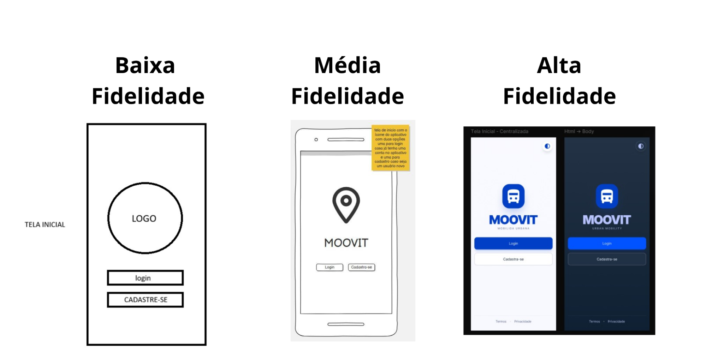
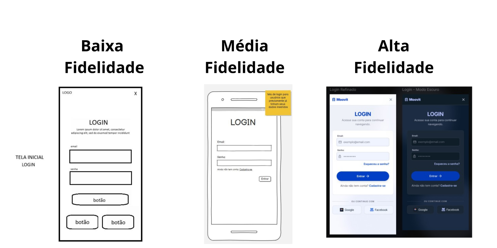
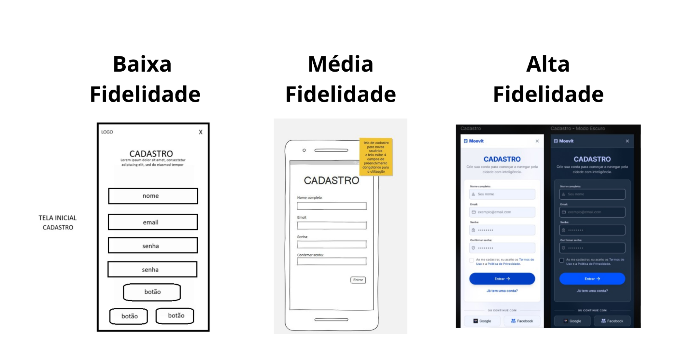
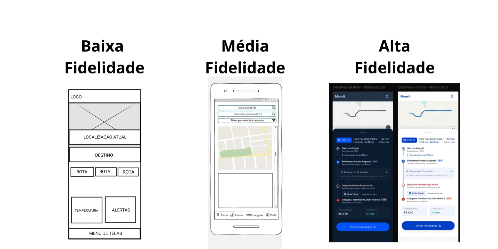
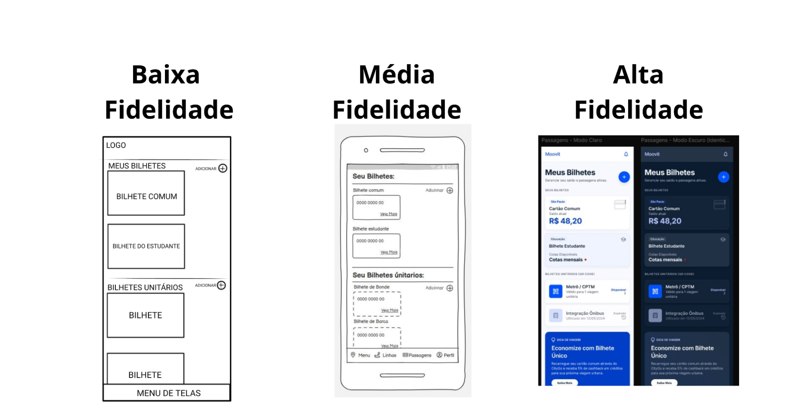
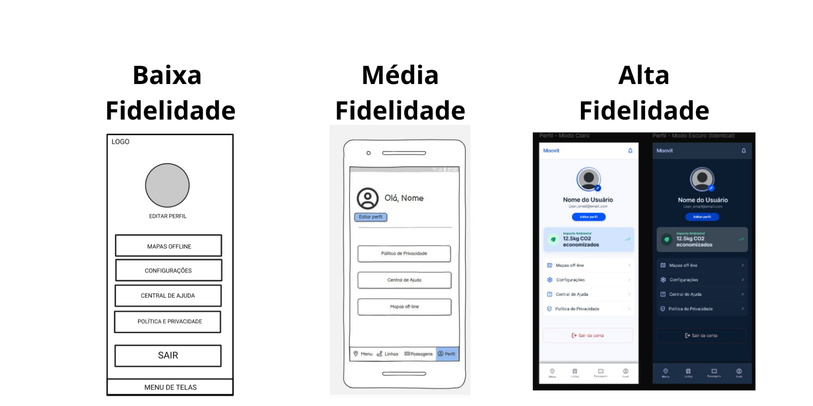

# Redesign-do-aplicativo-moovit
## Integrantes do projeto

|Nome dos participantes|
| :---- | 
| Alex Christini dos Santos |  | vitoriachristini2019-oss |
| Carolina Ayumi Kawakami Faria |
| Guadalupe Comba| 
|Isabelly Pereira de França|
| Lucas Silva de Morais|

## Introdução do Projeto
o projeto tem como objetivo propor o redesign da interface do aplicativo Moovit, com base em uma análise prévia de usabilidade. A proposta busca melhorar a organização das informações, reduzir a carga cognitiva e tornar a navegação mais intuitiva, especialmente em situações que exigem rapidez e clareza, como deslocamentos urbanos em horários de pico ou em contextos de vulnerabilidade.
Para o desenvolvimento do projeto, foram utilizadas metodologias de design centrado no usuário, incluindo a definição de personas, o mapeamento da jornada do usuário e a criação de protótipos de média fidelidade por meio da ferramenta Balsamiq. A partir dessas etapas, foram identificados pontos críticos da interface atual e elaboradas soluções que priorizam a simplicidade, a eficiência e a acessibilidade.

## Descrição do processo
O processo de desenvolvimento do protótipo de interface foi conduzido de forma estruturada, com o objetivo de identificar problemas no aplicativo original e propor melhorias voltadas à experiência do usuário. Inicialmente, realizou-se um levantamento e análise dos principais problemas presentes no aplicativo original, considerando aspectos como usabilidade, organização visual e navegação. Essa etapa foi fundamental para compreender as limitações existentes e definir os pontos que necessitavam de melhoria.  foi desenvolvido um protótipo de baixa fidelidade, elaborado manualmente, com o objetivo de estruturar as ideias iniciais de layout e navegação de forma rápida e simplificada, sem a preocupação com detalhes visuais. Em seguida, o protótipo foi refinado para uma versão de média fidelidade, utilizando a ferramenta Balsamiq, permitindo uma melhor organização dos elementos da interface e uma visualização mais clara da estrutura das telas. Na etapa seguinte, utilizou-se a ferramenta Google Stitch para a geração de protótipos de alta fidelidade. Foram inseridos os wireframes desenvolvidos anteriormente, juntamente com descrições detalhadas (prompts), indicando as características desejadas para o design final das telas.
Após a obtenção de versões consideradas adequadas, o protótipo foi transferido para o Figma, onde foram realizados ajustes visuais, organização dos componentes e aprimoramento da interface. Nessa etapa, também foi desenvolvida a prototipagem interativa, possibilitando a simulação da navegação entre as telas do aplicativo. 
## Criação do modelo de baixa fidelidade 
O Ibis paint foi utilizado para a criação do modelo de baixa fidelidade, utilizando elementos simples como: circulos, caixas e trechos de textos que indicassem a função de cada elemento. O modelo é simples e objetivo, se mostra extremamente útil para marcar como o modelo deve ser realizado.
## Criação do modelo de média fidelidade
O Balsamiq foi o primeiro software utilizado na criação do design do aplicativo. Sua utilização mostrou-se relevante por disponibilizar componentes visuais pré-definidos, o que facilitou a representação das ideias do grupo e a organização inicial da interface. Dessa forma, a ferramenta contribuiu para a rápida construção do protótipo de média fidelidade, permitindo maior clareza na definição da estrutura das telas.
## Criação do modelo de alta fidelidade
O Figma foi utilizado para a realização da prototipagem do aplicativo, bem como para a execução de ajustes pontuais na interface. Entre as principais alterações realizadas, destacam-se a definição e padronização das cores, a escolha das fontes tipográficas e a inserção de ícones, elementos fundamentais para a construção de uma identidade visual consistente.

## Modelos de  baixa, média e alta fidelidade.
#### **Tela inicial**

#### **Tela de Login**

#### **Tela de Cadastro**

#### **Tela de mapas**

#### **Tela de bilhetes**

#### **Tela de conta do usuário**

## Considerações finais
A realização deste projeto permitiu compreender a importância do design de interface como elemento essencial na qualidade da experiência do usuário em aplicativos de mobilidade urbana. A partir da análise do aplicativo Moovit, foi possível identificar falhas relacionadas principalmente ao excesso de informações, à complexidade dos fluxos de navegação e à dificuldade de acesso rápido às funcionalidades principais.Com base nesses problemas, o projeto de redesign apresentou soluções voltadas à simplificação da interface, à reorganização da arquitetura da informação e à priorização de elementos realmente relevantes para o usuário.

